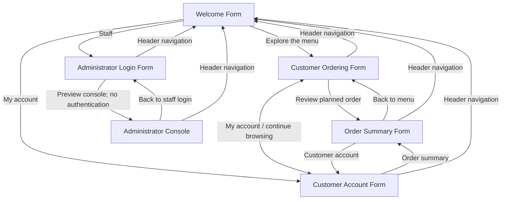

# Olive Branch Bakes — Phase 2 Navigation Diagram

**Actual Phase 2 behavior:** every arrow above is a UI navigation action. The five main pages are accessible using the shared top navigation. The admin console is deliberately reached via the **Preview Admin Console** button on the admin login page. The top **STAFF** item returns to admin login.

**Not implemented:** sign-in, accounts, cart persistence, pricing math, payment, inventory, database, or real order administration.
